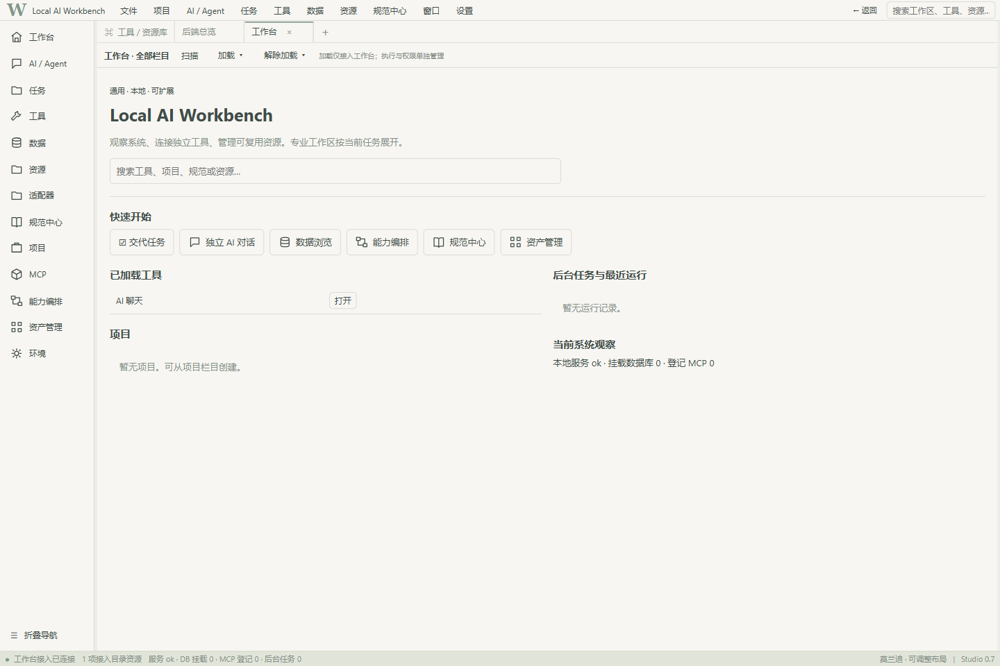
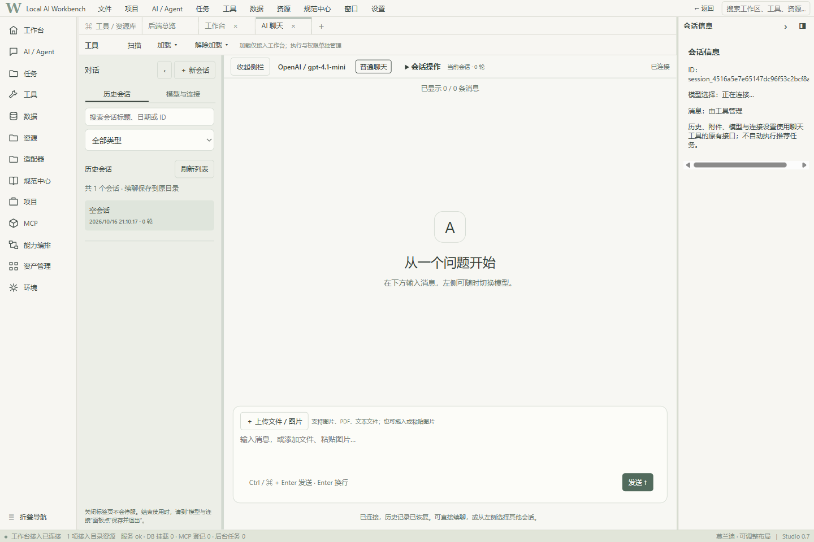
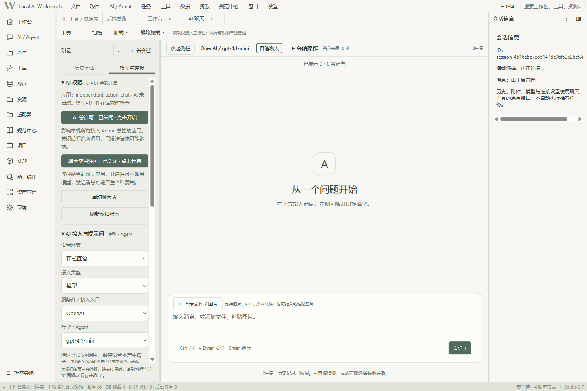

<p align="center">
  
</p>

# Baigong · Local AI Workbench Frontend

[简体中文](README.md) | **English**

A desktop workbench that retains the core management framework and loads only **AI Chat** by default. This source release contains no personal conversations, business databases, loaded external resources, model weights, or credentials. The AI Customer Acquisition Center is not included.

This repository provides the frontend source publicly. The frontend requires its companion backend; it is not a standalone web page that can call models on its own.

## Download and installation

Use the [workbench-backend branch of baigong](https://github.com/David7583/baigong/tree/workbench-backend) for the backend, **not** its data-pipeline `main` branch. Use this repository's `main` branch for the frontend. Git cloning is recommended. Alternatively, use **Code → Download ZIP** in each repository and rename the extracted folders as shown below.

Validation has covered Windows x64 with Python 3.12, Node.js 24, and Git. Desktop operation on other operating systems has not been verified. Installing dependencies requires internet access. Model calls require your own model service and explicit permission.

```powershell
git clone --branch workbench-backend --single-branch https://github.com/David7583/baigong.git baigong
git clone https://github.com/David7583/baigong-workbench-frontend.git baigong-workbench-frontend
cd baigong
python -m venv .venv
& .\.venv\Scripts\python.exe -m pip install -r requirements.lock.txt
& .\.venv\Scripts\python.exe setup_workbench_v0001.py
cd ..\baigong-workbench-frontend
npm ci
npm start
```

Keep the two folders next to each other. Paths resolve relative to the scripts; no specific drive letter is required. If you use a different backend folder name or location, set its path before starting:

```powershell
$env:WORKBENCH_BACKEND_ROOT = (Resolve-Path '..\my-backend-folder').Path
npm start
```

You can explicitly select the backend Python interpreter with `WORKBENCH_PYTHON`. On Windows, background chat prefers `pythonw.exe` from the same environment and does not launch through PowerShell. Standard output and errors are saved in the backend launch logs.

Electron may download its binary on first launch. If your network cannot reach GitHub Releases, configure your own proxy and run `npx install-electron --no`. Do not disable TLS verification. The release dependencies were installed with `npm ci`; desktop validation used an existing Electron 44.4.5 binary of the same version. A local download failure means that installation on a new computer has **not** been fully verified.

## Your first chat

1. On the home screen, click **独立 AI 对话** (Independent AI Chat). You can open the interface, manage conversations, and inspect settings without an API key. The screenshots and current interface use Chinese labels.
2. Configure your own model service in the backend. The default example uses OpenAI's `gpt-4.1-mini`; availability depends on your account and the service response. You can edit the backend model catalog and chat configuration.
3. Set `OPENAI_API_KEY` in the environment used to launch the workbench. Never commit credentials to Git. In the chat page's **模型与连接** (Models and Connections) settings, explicitly enable both global permission and application permission. Both are disabled initially.
4. Send a message. Missing service configuration or permission produces an actual error, not a demonstration response. Conversation history and runtime state are stored locally in the backend directory and persist across restarts.

Other sections provide core management entry points and initially have no business resources loaded. You control scanning, selection, loading, and unloading; unloading does not delete original files. Some specialized resources require additional dependencies. This package does not include every plugin, application, database, or vector-retrieval environment.

## Screenshots

These are actual screenshots from an isolated, empty environment. They contain no personal data, simulated sales results, or fabricated model responses.







## Structure and validation

- `desktop/`: Sandboxed Electron window and restricted desktop bridge.
- `workspace/`, `visualization/`: Workbench views and shared graph contracts.
- `chat/`: The existing chat interface. APIs, model calls, and data storage live in the backend.
- `tests/`: Isolated desktop regression tests. Point them at a test backend run copy, never your personal workbench.

```powershell
$env:WORKBENCH_BACKEND_ROOT = (Resolve-Path '..\test-backend').Path
npm test
```

See the [release validation notes](docs/RELEASE_VALIDATION.md) (in Chinese) for the validation record and limitations. This project uses Baigong's Apache-2.0 license. Third-party static assets retain their own licenses, and npm dependencies are not bundled with the source.
